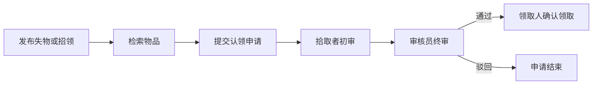

# 项目说明

> 状态：需求候选版｜更新：2026-11-27

## 项目定位

校园失物信息散在班级群、校园墙和保卫处登记簿里。群聊能快速传播消息，但消息容易被刷走，也无法判断认领人是否真是失主。

本项目建设一个校园失物招领网站，把发布、检索、认领审核和领取确认放在同一条流程里。系统重点记录“谁提出了认领、依据是什么、谁审核、何时领取”，不承诺自动判断物品归属。

## 用户与角色

| 角色 | 职责 |
|---|---|
| 学生 | 检索、发布失物、提交认领、确认领取、举报 |
| 拾取者 | 发布招领、查看认领答案、提交初审建议 |
| 审核员 | 终审认领、处理举报、查看审核记录 |
| 管理员 | 用户、角色、基础配置和审计管理 |
| 系统 | 过期处理、通知投递、定时任务 |

同一账号可以同时具有学生和拾取者身份。审核员不能审核自己提交或发布的相关申请。

## 核心流程

拾取者熟悉实物，负责给出初审意见。审核员负责最终结论。领取人在线下拿到物品后点击确认；该记录表示领取人的陈述，不能单独证明线下确实完成交付。

## 本期范围

### 必做

- 统一身份认证适配层，课程演示可使用本地账号。
- 发布失物和招领。
- 招领必须设置至少一个核验问题。
- 按分类、地点、时间和关键词检索。
- 提交认领申请并保存核验答案和材料。
- 拾取者初审、审核员终审。
- 获准领取人确认领取。
- 同一物品只能有一条进行中申请。
- 手机号脱敏、原图访问控制、关键操作审计。
- 站内消息和基础的自动过期处理。

### 暂不做

- 站内即时聊天、二手交易、快递代取、跨校流转。
- 自建密码体系。
- AI 或模型自动判断认领真伪。
- v0.1 中的志愿者排班、信用分和申诉。
- v0.1 中的报表、OCR、关键词订阅和开放 API。

## 三阶段交付

| 版本 | 交付目标 |
|---|---|
| v0.1 | 完成一条可运行的认领主流程 |
| v0.2 | 补齐资料、通知、举报、审计和管理功能 |
| v0.3 | 增加相似匹配、订阅和导出能力 |

## 当前证据

| 结论 | 证据 |
|---|---|
| 认领核验是现有渠道的共同空缺 | 竞品桌面分析 |
| 拾取者担心责任和骚扰 | 推演，尚未访谈 |
| 保卫处愿意承担终审 | 未确认 |
| 失主愿意使用核验问题 | 未确认 |
| 校园统一认证可以接入 | 未授权，未实测 |
| 通知通道可以接入 | 未授权，未实测 |
| 检索和并发方案可运行 | 有独立探测脚本，尚未进入业务系统 |

当前没有真实访谈、问卷、现场观察或业务方签字。项目可以继续做课程原型，但不能声称已经证明用户需求或具备上线条件。

## 成功标准

1. 一条招领可以从发布走到领取确认，状态和记录一致。
2. 同一物品出现并发认领时，只产生一条进行中申请。
3. 非授权用户可以访问的响应中没有未脱敏手机号或其他受保护内容。
4. 审核员能查看申请材料、初审意见并提交一次终审结论。
5. 最终版本至少有一项真实外部集成，或者如实标注为课程模拟。

## 主要风险

| 风险 | 影响 | 处理 |
|---|---|---|
| 双人审核缺少真实业务承接方 | 流程上线后无人处理 | 先访谈招领处；未确认前作为课程原型 |
| 核验问题过于简单 | 核验价值下降 | 限制问题内容，要求审核员结合材料判断 |
| 一条申请长期占用物品 | 后续申请人无法进入 | 保留撤回和超时处理，但不计入 v0.1 主流程 |
| 图片遮蔽影响辨认 | 公开图片无法帮助寻找 | 按物品风险决定遮蔽方式，原图仅授权查看 |
| 外部接口未授权 | 演示依赖模拟实现 | 使用适配器，报告明确真实和模拟部分 |

## 待确认

- 终审由保卫处老师、课程教师还是组内成员承担。
- 哪一项外部集成能够在课程期间真实接入。
- 手机号可见范围是否需要扩展到送达后的双方联系。
- 普通低价值物品是否需要与证件类物品使用同一审核流程。
