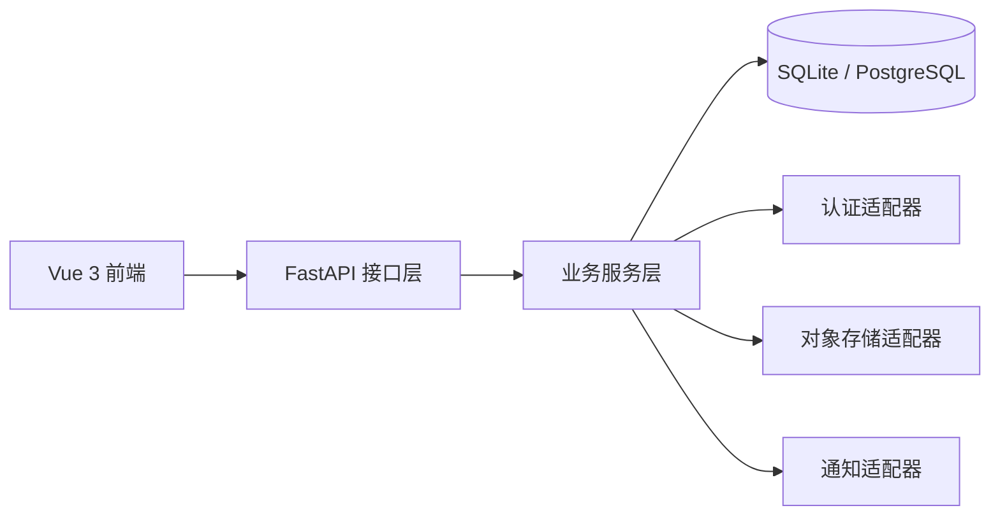
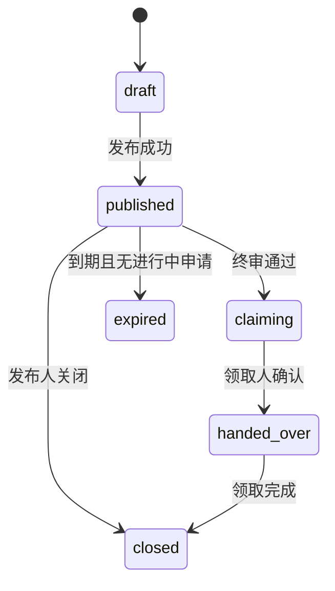
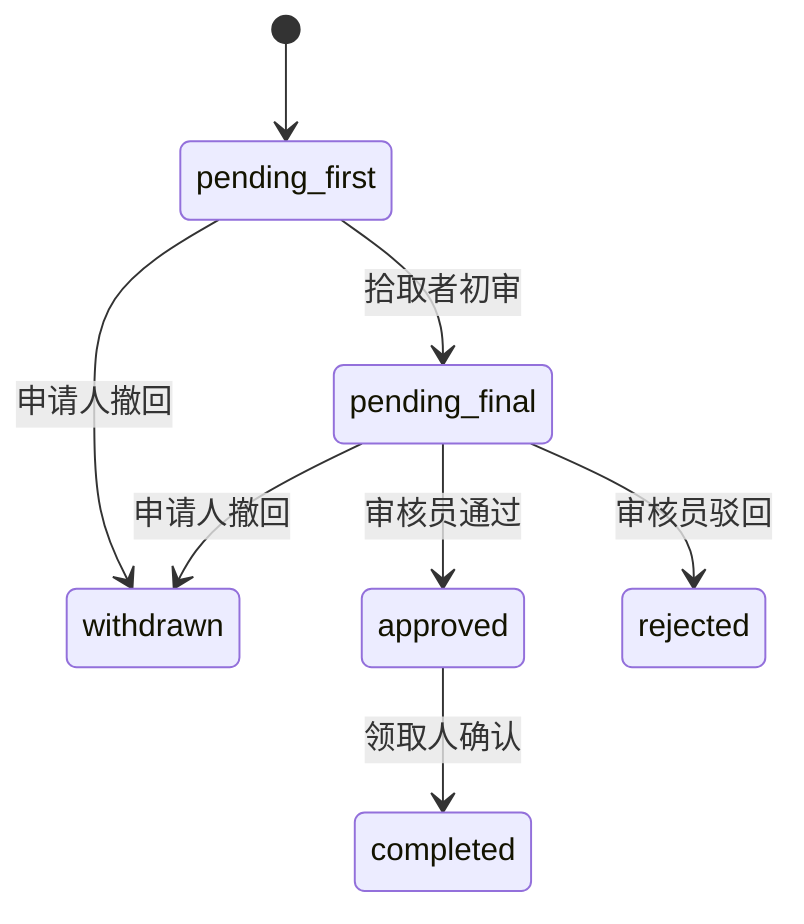

# 系统设计

> 状态：预研方案，随需求评审调整｜更新：2026-11-27

## 架构



前端调用 REST API。接口层负责参数校验、鉴权和错误映射，服务层负责事务、状态迁移和字段可见性。认证、存储和通知通过适配器隔离外部系统。

开发环境使用 SQLite、本地磁盘和本地登录。部署时可替换为 PostgreSQL、对象存储和学校统一认证。当前没有完成这些生产适配器的真实接入。

## 核心数据

| 实体 | 主要字段 |
|---|---|
| `user` | 学工号、姓名、院系、手机号、信用分、认证来源 |
| `role` / `permission` / `user_role` | 角色、能力、角色授予 |
| `item` | 类型、标题、描述、分类、地点、时间、联系人、状态、版本 |
| `item_image` | 原图地址、遮蔽图地址、上传状态 |
| `verification_question` | 问题、加密答案 |
| `claim_application` | 申请人、理由、材料、证据版本、状态、版本 |
| `claim_answer` | 申请、问题、申请人填写的答案 |
| `review_record` | 初审或终审、结论、理由、审核人、时间 |
| `pickup_arrangement` | 领取地点、日期、时段、公用联系渠道 |
| `handover_confirmation` | 申请、物品、确认人、确认时间 |
| `notification` | 用户、类型、标题、正文、已读时间 |
| `audit_log` | 操作人、动作、对象、元数据、时间 |

失物和招领共用 `item` 表，用 `kind` 区分。招领必须有核验问题，失物不需要。

## 状态

### 发布



- `published`：可以检索和申请。
- `claiming`：已有申请通过终审，等待领取。
- `handed_over`：领取人已确认。
- `closed`：不再接收申请。
- `expired`：超过有效期且没有进行中申请。

### 认领



- `pending_first`：等待拾取者初审。
- `pending_final`：等待审核员终审。
- `approved`：终审通过，等待领取。
- `completed`：领取人已确认。
- `rejected` / `withdrawn`：申请结束并释放占位。

状态迁移由服务层统一处理。非法迁移返回 `409 ITEM_STATE_INVALID`。

## 认领互斥

同一招领最多有一条进行中申请。SQLite 和 PostgreSQL 都支持部分唯一索引：

```sql
CREATE UNIQUE INDEX uq_claim_active
ON claim_application(item_id)
WHERE status IN ('pending_first', 'pending_final', 'approved');
```

提交申请和检查名额放在同一个事务中。唯一约束冲突返回 `409 CLAIM_CONFLICT`。审核、撤回和领取确认同时校验 `claim_application.version`，避免旧页面重复提交。

## 接口

| 方法 | 路径 | 用途 |
|---|---|---|
| `POST` | `/api/v1/auth/dev-login` | 演示登录 |
| `GET` | `/api/v1/auth/sso/login` | 发起统一认证 |
| `GET` | `/api/v1/auth/sso/callback` | 处理认证回调 |
| `GET` | `/api/v1/items` | 检索发布 |
| `POST` | `/api/v1/items` | 发布失物或招领 |
| `GET` | `/api/v1/items/{id}` | 查看发布详情 |
| `PATCH` | `/api/v1/items/{id}` | 编辑本人发布 |
| `POST` | `/api/v1/items/{id}/close` | 关闭发布 |
| `POST` | `/api/v1/items/{id}/images` | 上传图片 |
| `POST` | `/api/v1/items/{id}/claims` | 提交认领 |
| `GET` | `/api/v1/claims/{id}` | 查看申请详情 |
| `POST` | `/api/v1/claims/{id}/withdraw` | 撤回申请 |
| `POST` | `/api/v1/claims/{id}/first-review` | 提交初审建议 |
| `POST` | `/api/v1/claims/{id}/final-review` | 提交终审结论 |
| `POST` | `/api/v1/claims/{id}/handover` | 确认领取 |
| `GET` | `/api/v1/notifications` | 查看站内消息 |

统一使用 Bearer token。请求和响应使用 UTF-8 JSON，时间统一为 ISO 8601。

| 错误码 | HTTP | 含义 |
|---|---:|---|
| `UNAUTHORIZED` | 401 | 未登录或 token 失效 |
| `FORBIDDEN` | 403 | 无权限 |
| `NOT_FOUND` | 404 | 资源不存在且允许公开 |
| `VALIDATION_ERROR` | 422 | 字段校验失败 |
| `ITEM_STATE_INVALID` | 409 | 当前状态不允许该操作 |
| `CLAIM_CONFLICT` | 409 | 物品已有进行中申请 |
| `CLAIM_ALREADY_EXISTS` | 409 | 本人已有进行中申请 |
| `EVIDENCE_LOCKED` | 409 | 认领开始后核验字段已锁定 |

## 权限与隐私

- 后端按角色、能力和资源归属共同判定权限。
- 只在前端隐藏按钮不构成权限控制。
- 手机号在响应序列化阶段脱敏。本人可以查看自己的号码。
- 审核员只能在案件范围内查看必要明文，并写 `pii.read` 审计。
- 普通发布只返回遮蔽图。原图使用短期签名地址，并写访问审计。
- 审计日志只记录操作人和对象元数据，不记录认领理由、聊天内容或完整申请材料。

## 图片处理

上传后校验格式和大小，并生成公开遮蔽图。核验字段锁定后，不允许替换图片。

证件或面单类图片应采用遮蔽敏感区域的版本。当前方案用模糊图做课程演示，公开图可能不适合辨认物品，这是已知限制。OCR 定位留到后续版本。

## 通知

业务事务先写站内消息。外部通道失败不回滚审核或领取结果。微信和邮件没有授权时使用本地适配器，演示记录必须标注为模拟投递，不能写成真实送达。

## 已知限制

- 单实例部署，定时任务和 API 同进程。
- SQLite 只有一个写锁，并发写压力大时需要 PostgreSQL。
- 领取确认是领取人的自述，不能单独证明线下交付。
- 图片遮蔽没有按敏感区域处理，OCR 尚未实现。
- 统一认证、对象存储和通知均未完成真实接入。
