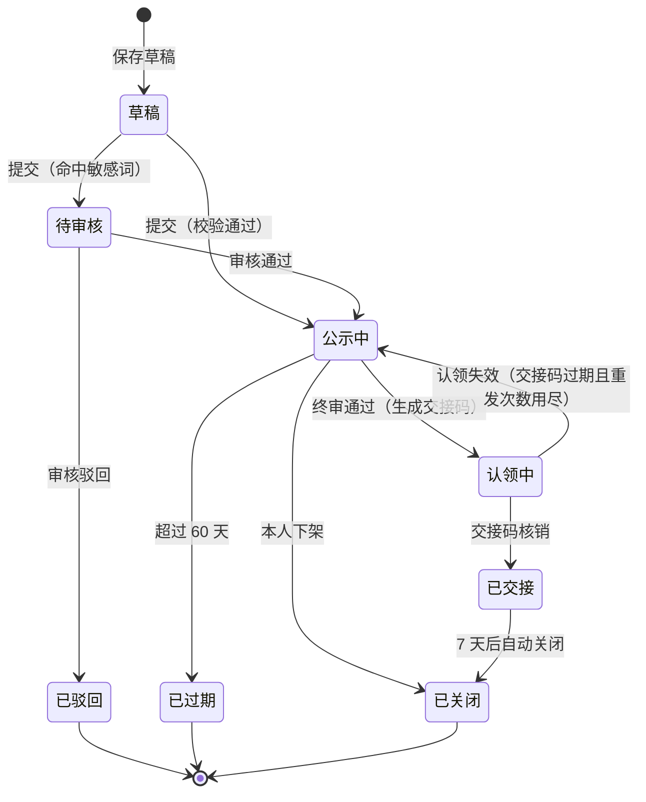
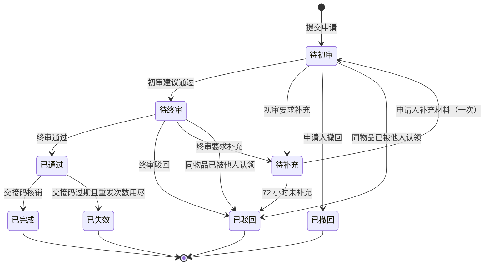
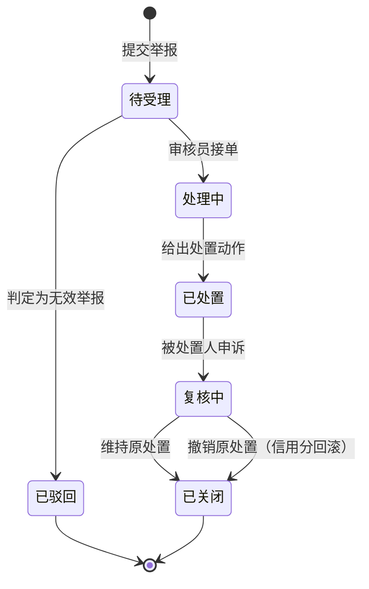
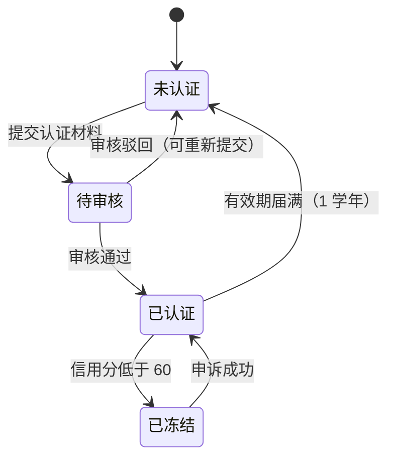

# 行为模型

> 对应单元：3 需求建模｜检查点：第 4 次课（草稿）、第 5 次课（定稿）
> 负责人：架构 / 设计工程师｜状态：草稿，待评审
> 依据：[选题文稿](../00-立项/选题文稿.md) 第十三节、[SRS 第 4 章](../02-需求规约/SRS-v1.0.md)

## 1. 状态图

课程要求至少 2 个关键类的状态图。本项目给出 4 个：发布、认领申请、举报、拾取者认证。
状态图用 Mermaid `stateDiagram-v2` 写在本文档里（GitHub 直接渲染），同时把 PlantUML 版本存入
`models/state/` 供导出 PDF 时使用。

### 1.1 发布（失物 / 招领）Item



> **约束 1**：`公示中 → 认领中` 只能由终审通过触发，且必须在事务内同时驳回其余进行中申请。
> **约束 2**：进入 `认领中` 后禁止修改特征描述与图片（防串供），编辑接口返回 409。
> **约束 3**：`认领中 → 公示中` 是唯一的回退路径，用于交接码过期且无法重发的情况。

### 1.2 认领申请 ClaimApplication



> **约束 1**：同一 `found_item_id` 在同一时刻最多 1 条处于 `待初审/待终审/待补充/已通过` 的申请（数据库唯一索引保证）。
> **约束 2**：`待补充` 只能补充一次，第二次补充请求返回 409。
> **约束 3**：`已撤回` 与 `已驳回` 是终态，不可再流转；重新申请会产生新记录。

### 1.3 举报 Report



> **约束**：`复核中` 期间处置不撤销，但暂缓升级（不触发永久封禁）；复核人不能是原处置人。

### 1.4 拾取者认证 FinderCertification



> **约束**：`已冻结` 期间不能发布招领，但可以初审已有申请——避免已在进行中的认领卡死。

## 2. 顺序图

| 编号 | 场景 | 源文件 | 重点表达 |
|---|---|---|---|
| SD-01 | 提交认领申请（含并发冲突） | `models/sequence/sd01-submit-claim.puml` | 唯一约束、409 返回、通知异步 |
| SD-02 | 终审通过（事务 + 交接码） | `models/sequence/sd02-final-review.puml` | 单事务内的多表更新、乐观锁、驳回其余申请 |
| SD-03 | 交接码核销 | `models/sequence/sd03-handover.puml` | 幂等核销、过期判定、并发只成功一次 |
| SD-04 | 通知投递与降级 | `models/sequence/sd04-notify-fallback.puml` | 通道顺序、失败降级、投递记录、重启补扫 |

渲染：`java -jar plantuml.jar -tpng -charset UTF-8 models/sequence/sd02-final-review.puml`

### 2.1 SD-02 终审通过（文字版，便于评审对照图）

```
审核员 → API: POST /claims/{id}/review {action: approve, comment}
API   → 权限: 校验 claim:review_final 且 非申请人/非发布人
API   → 服务: approve(claim_id, version)
服务  → DB: BEGIN
服务  → DB: UPDATE claim SET status='已通过' WHERE id=? AND version=? AND status='待终审'
服务  → DB: 若 rowcount=0 → ROLLBACK → 409（已被处理）
服务  → DB: INSERT handover_token(码哈希, 72h)
服务  → DB: UPDATE claim SET status='已驳回', reason='已被他人认领' WHERE found_item_id=? AND status IN ('待初审','待终审','待补充')
服务  → DB: UPDATE found_item SET status='认领中' WHERE id=? AND status='公示中'
服务  → DB: INSERT item_status_log ×2、INSERT audit_log
服务  → DB: COMMIT
服务  → 通知: 异步投递（不阻塞返回）
API   → 审核员: 200 {claim, token_expires_at}
```

### 2.2 SD-04 通知投递与降级（文字版）

```
定时任务 → 服务: 扫描 status='pending' AND plan_at <= now()
服务   → DB: UPDATE delivery SET status='sending' WHERE id=? AND status='pending'  -- 乐观锁
服务   → 微信适配器: send(msg)
微信适配器 → 服务: 失败（未关注/额度用尽/超时）
服务   → DB: INSERT delivery_log(通道=wechat, 结果=failed, 耗时)
服务   → 邮件适配器: send(msg)
邮件适配器 → 服务: 成功
服务   → DB: UPDATE delivery SET status='sent'、INSERT delivery_log(通道=email, 结果=ok)
备注：站内消息在进入队列时即写入，不依赖投递结果（必达通道）
```

## 3. 活动图

| 编号 | 用例 | 源文件 |
|---|---|---|
| ACT-06 | 发布招领并设置核验问题 | `models/sequence/act-uc06-publish-found.puml` |
| ACT-15 | 提交认领申请 | `models/sequence/act-uc15-submit-claim.puml` |
| ACT-18 | 审核员终审 | `models/sequence/act-uc18-final-review.puml` |
| ACT-19 | 交接码核销 | `models/sequence/act-uc19-handover.puml` |

## 4. 与需求的一致性自查

| 检查项 | 结论 | 证据 |
|---|---|---|
| 每个状态都能在需求中找到触发条件 | ✅ | 每条迁移在 SRS §4 或 FR 中有对应描述 |
| 每个状态迁移都有对应测试用例 | ✅ | 见 [测试用例库](../05-测试/测试用例库.md) 状态迁移专项 |
| 无孤立状态（进得去出不来） | ✅ | 4 张图的终态都可达 |
| 状态数与数据库枚举一致 | ✅ | 见 [数据库设计](../04-设计/数据库设计.md) §3 状态枚举 |
| 并发路径有唯一约束或乐观锁保护 | ✅ | 唯一索引 `uq_claim_active`、`version` 字段 |
