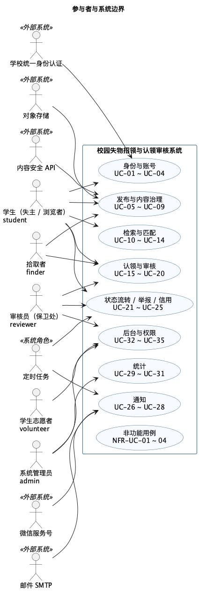
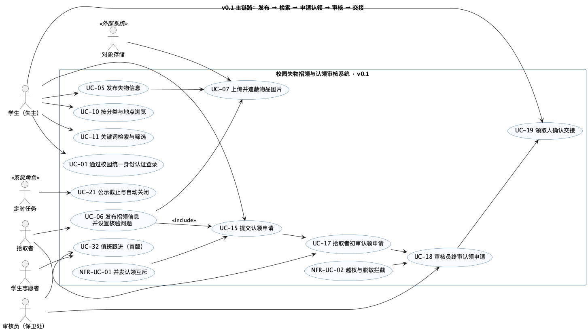
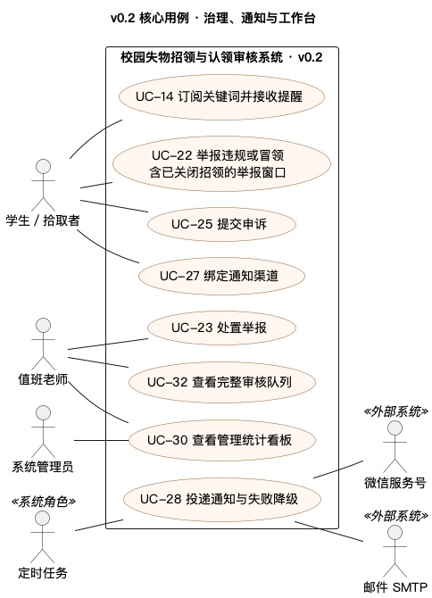
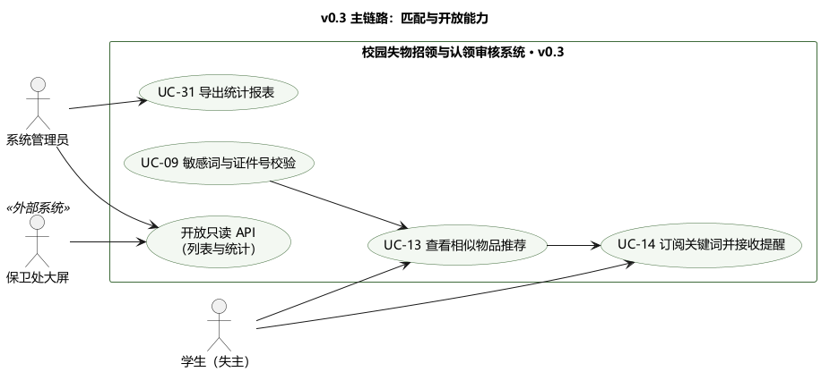

# 用例模型

> 对应单元：3 需求建模｜检查点：第 3 次课（第 11 周，讲解用例图与完整需求）、第 4/5 次课（定稿）
> 负责人：需求分析师｜状态：初稿（第 3 次课讲解用），第 4/5 次课按互查意见定稿
> 数据源：[用例清单](../02-需求规约/用例清单.md)（39 个用例）、[SRS v1.0](../02-需求规约/SRS-v1.0.md)

## 1. 参与者

### 1.1 主参与者

| 参与者 | 类型 | 说明 | 用例数 |
|---|---|---|---|
| 学生（失主 / 浏览者） | 人 | 检索、发布失物、提交认领、举报、接收通知 | 16 |
| 拾取者 | 人 | 发布招领、初审认领、登记保管、查看交接进度 | 6 |
| 审核员（保卫处 / 失物招领处） | 人 | 终审认领、处置举报、审核认证、维护基础数据 | 6 |
| 学生志愿者 | 人 | 分派案件的脱敏摘要、催办和登记 | 1 |
| 系统管理员 | 人 | 用户与角色、配置、审计、报表 | 4 |
| 定时任务 | 系统角色 | 自动过期、超时升级、通知补扫、订阅匹配 | 3 |

> 同一账号可同时是学生与拾取者（认证通过后角色叠加）。审核员与管理员由保卫处授予，不开放自助申请。

### 1.2 次参与者

| 参与者 | 被谁调用 | 用在哪里 |
|---|---|---|
| 学校统一身份认证 | 系统 | UC-01 登录（OAuth2 授权码） |
| 对象存储 | 系统 | UC-07 图片上传与遮蔽、UC-18 原图查看 |
| 微信服务号 | 系统 | UC-20、UC-27、UC-28 通知主通道 |
| 邮件 SMTP | 系统 | UC-20、UC-27、UC-28 通知兜底 |
| 内容安全 API（v0.3 可选） | 系统 | UC-09 敏感词判定 |

## 2. 模块总览

> 39 个用例按 8 个功能模块 + 1 个非功能模块组织。**分增量的图代替单张总览图**，原因见第 5 节。

| 模块 | 用例 | 数量 |
|---|---|---|
| A 身份与账号 | UC-01 ~ UC-04 | 4 |
| B 发布与内容治理 | UC-05 ~ UC-09 | 5 |
| C 检索与匹配 | UC-10 ~ UC-14 | 5 |
| D 认领与审核 | UC-15 ~ UC-20 | 6 |
| E 状态流转、举报与信用 | UC-21 ~ UC-25 | 5 |
| F 通知 | UC-26 ~ UC-28 | 3 |
| G 统计 | UC-29 ~ UC-31 | 3 |
| H 后台与权限 | UC-32 ~ UC-35 | 4 |
| N 非功能用例 | NFR-UC-01 ~ 04 | 4 |
| **合计** | | **39** |

## 3. 分增量用例图

> 每张图只画一个增量的主链路（5–8 个用例），保证在 8 分钟讲解里能讲清。

| 图 | 覆盖 | 源文件 | 渲染产物 |
|---|---|---|---|
| 参与者与系统边界 | 6 类参与者 + 系统边界 | `models/usecase/usecase-actors.puml` | `docs/assets/usecase-actors.png` |
| v0.1 主链路 | 发布 → 检索 → 认领 → 审核 | `models/usecase/usecase-v01.puml` | `docs/assets/usecase-v01.png` |
| v0.2 主链路 | 举报、通知、统计、权限 | `models/usecase/usecase-v02.puml` | `docs/assets/usecase-v02.png` |
| v0.3 主链路 | 匹配与开放能力 | `models/usecase/usecase-v03.puml` | `docs/assets/usecase-v03.png` |

### 3.1 参与者与系统边界

### 3.2 v0.1 主链路：发布 → 检索 → 认领 → 审核

这条链路是项目的价值底线。注意三个设计点：

1. **UC-17 与 UC-18 是两个不同的用例，不是同一个。** 初审由拾取者做（他知道自己捡到的是什么），终审由审核员做（他有权限看原图与申请人历史）。合并成一个会让"谁负责"变模糊。
2. **UC-19 是独立的用例。** 终审通过后，获准领取人现场验物并确认，需覆盖重复点击和逾期未确认。
3. **UC-21 由定时任务触发。** 它不在任何人的操作路径上，但必须有——否则发布永远停在"公示中"。

### 3.3 v0.2 主链路：举报、通知、统计、权限

这一期解决"跑得下去"的问题：有人虚报要能举报，审核结论要能通知到人，管理者要能看到数字，权限要能拦住越权。

### 3.4 v0.3 主链路：匹配与开放能力

## 4. 细化用例

至少 3 个用例需细化到规约级并配活动图。本项目细化 4 个，规约见
[SRS 第 4 章](../02-需求规约/SRS-v1.0.md)。

| 用例 | 规约 | 活动图 | 状态 |
|---|---|---|---|
| UC-06 发布招领并设置核验问题 | SRS §4.1 | `models/sequence/act-uc06-publish-found.puml` | ✅ 完成 |
| UC-15 提交认领申请 | SRS §4.2 | `models/sequence/act-uc15-submit-claim.puml` | ✅ 完成 |
| UC-18 审核员终审 | SRS §4.3 | `models/sequence/act-uc18-final-review.puml` | ✅ 完成 |
| UC-19 领取人确认交接 | SRS §4.4 | `models/sequence/act-uc19-handover.puml` | ✅ 完成 |

活动图渲染：`java -jar plantuml.jar -tpng -charset UTF-8 models/sequence/act-uc18-final-review.puml`

## 5. 工具选择说明（重要）

### 5.1 实测结论

用 PlantUML 1.2024.x 实际渲染了四种规模：

| 图 | 用例数 | 工具 | 结果 | 可读性 |
|---|---|---|---|---|
| v0.1 主链路 | 8 | PlantUML | 1710×520 量级 | ✅ 清晰，可直接进文档 |
| v0.2 主链路 | 8 | PlantUML | 1900×600 量级 | ✅ 清晰 |
| v0.3 主链路 | 5 | PlantUML | 1300×420 量级 | ✅ 清晰 |
| 全部 39 个用例一张图 | 39 | PlantUML | 自动布局排成细长条 | ❌ 不可用 |

**结论：PlantUML 适合画单增量的中小图（≤10 个用例），不适合画 39 个用例的总览图。**
总览用"模块表 + 分增量图"替代，不强行画一张大图。

### 5.2 为什么不用 Mermaid

Mermaid **没有原生用例图语法**。它只能用 `flowchart` 画方框和圆，画出来没有 actor 小人、没有系统边界、没有 include/extend 语义，评审一眼能看出不是标准 UML 用例图。

Mermaid 该用在：状态图（`stateDiagram-v2`）、时序图（`sequenceDiagram`）、ER 图、流程图——本项目正是这么分工的。

### 5.3 推荐方案

| 图 | 工具 | 理由 |
|---|---|---|
| 用例图（分增量） | PlantUML | 已验证清晰；纯文本可进 git，一图一 PR |
| 活动图 | PlantUML | 分支与泳道表达清楚 |
| 顺序图 | PlantUML | 调用次序与异步投递一目了然 |
| 状态图 | Mermaid `stateDiagram-v2` | 语法原生支持，GitHub 直接渲染 |
| ER 图 | Mermaid `erDiagram` | 同上 |

### 5.4 图形规范（评审会看）

| 规则 | 做法 |
|---|---|
| 用例命名 | 动宾短语："提交认领申请"，不是"认领管理" |
| 主/次参与者 | 人用 `actor`，外部系统用 `actor <<外部系统>>`，系统角色用 `<<系统角色>>` |
| 系统边界 | 一个 `rectangle` 包住全部用例，标题写系统名 |
| include / extend | 只在真正复用时用；不确定就用普通关联线 |
| 不画什么 | 步骤（用活动图）、判断分支（活动图）、调用时序（顺序图）、界面 |

## 6. 自查清单

- [x] 参与者齐全，主/次分开标注
- [x] 39 个用例全部出现在清单中，编号与 SRS 一致
- [x] 用例名均为动宾短语
- [x] 每个用例至少关联一个参与者
- [x] 4 个用例细化到规约级并配活动图
- [x] 能手工复现每张图（源文件在 `models/`，渲染命令可复跑）
