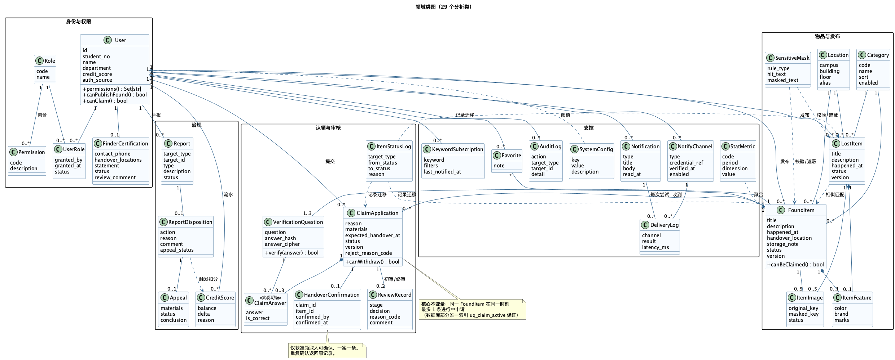

# 类模型

> 对应单元：3 需求建模｜检查点：第 4 次课（草稿）、第 5 次课（定稿）
> 负责人：架构 / 设计工程师｜状态：草稿，待评审
> 依据：[选题文稿](../00-立项/选题文稿.md) 第十二节 29 个分析类

## 1. 分析类清单

| 分组 | 分析类 | 数量 |
|---|---|---|
| 身份与权限 | AC-01 用户、AC-02 角色、AC-03 权限、AC-04 用户角色、AC-05 拾取者认证 | 5 |
| 物品与发布 | AC-06 分类、AC-07 地点、AC-08 失物发布、AC-09 招领发布、AC-10 物品图片、AC-11 物品特征、AC-12 敏感信息遮蔽 | 7 |
| 认领与审核 | AC-13 认领申请、AC-14 核验问题、AC-15 审核记录、AC-16 交接凭证、AC-17 状态变更日志 | 5 |
| 治理 | AC-18 举报、AC-19 举报处置、AC-20 信用分、AC-29 申诉 | 4 |
| 通知 | AC-21 通知、AC-22 通知渠道、AC-23 投递记录、AC-24 关键词订阅 | 4 |
| 支撑 | AC-25 收藏、AC-26 审计日志、AC-27 统计指标、AC-28 系统配置 | 4 |
| **合计** | | **29** |

## 2. 类图

> 源文件 `models/class/domain.puml`，一图一 PR；渲染产物 `docs/assets/domain.png`。图中另有实现明细 `ClaimAnswer`，课程分析类清单仍为 29 个。
> 渲染命令：`java -jar plantuml.jar -tpng -charset UTF-8 models/class/domain.puml`

### 2.1 图的分层约定

| 层 | 类 | 说明 |
|---|---|---|
| 身份层 | User、Role、Permission、UserRole、FinderCertification | 能力判定与实名认证 |
| 内容层 | Category、Location、LostItem、FoundItem、ItemImage、ItemFeature、SensitiveMask | 发布与治理 |
| 流程层 | ClaimApplication、VerificationQuestion、ReviewRecord、HandoverConfirmation、ItemStatusLog | 认领审核主链路 |
| 治理层 | Report、ReportDisposition、CreditScore、Appeal | 违规处置与申诉 |
| 支撑层 | Notification、NotifyChannel、DeliveryLog、KeywordSubscription、Favorite、AuditLog、StatMetric、SystemConfig | 通知、统计、审计 |

### 2.2 为什么把"失物"和"招领"分成两个类

两者字段 80% 相同，但**行为不同**：招领必须带核验问题、必须有交接地点、可以初审；失物没有核验问题、不能初审。
两个分析类共享数据库中的 `item` 表及 `kind` 判别字段。发布服务在事务内校验招领必须带核验问题，检索使用共享表。见 [数据库设计](../04-设计/数据库设计.md) §2。

## 3. CRC 卡

> 每个核心类一张。这里给出 7 张最关键的，其余类在 `models/class/domain.puml` 中以属性形式给出。

### CRC：招领发布 FoundItem

| 职责 | 协作者 |
|---|---|
| 持有标题、描述、分类、地点、拾取时间、保管方式、交接地点、状态、版本号 | Category, Location, User |
| 持有并约束核验问题（≥1 个） | VerificationQuestion |
| 判断是否可被认领（仍开放公示、无进行中申请且非本人发布） | ClaimApplication |
| 状态迁移：公示中 → 认领中 → 已交接 → 已关闭 | ItemStatusLog |
| 判断是否到达首次公示后 60 天的截止点 | — |

### CRC：认领申请 ClaimApplication

| 职责 | 协作者 |
|---|---|
| 持有理由、核验答案、材料、期望交接时间、状态、版本号 | User, FoundItem |
| 校验同一物品在任一时刻最多有 1 条进行中申请 | FoundItem |
| 正常路径为待初审 → 待终审 → 已通过（待领取）→ 已完成；补交、驳回、撤回与失效按状态图处理 | ItemStatusLog, ReviewRecord |
| 判断是否可撤回（待初审、待终审或待补充） | — |
| 提供申请人历史（申请次数、通过率）供审核参考 | ReviewRecord, CreditScore |

### CRC：核验问题 VerificationQuestion

| 职责 | 协作者 |
|---|---|
| 持有问题文本、答案哈希、答案密文、提示语 | FoundItem |
| 校验答案（只比对哈希，不返回明文） | ClaimApplication |
| 对失主只暴露问题文本，不暴露答案 | — |

### CRC：交接确认 HandoverConfirmation

| 职责 | 协作者 |
|---|---|
| 关联申请、物品，记录获准领取人和确认时间 | ClaimApplication、User |
| 同一申请最多一条，重复确认返回原记录 | ClaimApplication |
| 按归属授权查阅确认结果 | User |

### CRC：审核记录 ReviewRecord

| 职责 | 协作者 |
|---|---|
| 持有环节（初审/终审）、结论、理由码、审核人、时间 | ClaimApplication, User |
| 校验审核人不是申请人也不是发布人 | ClaimApplication |
| 校验同一环节只能提交一次 | — |

### CRC：举报处置 ReportDisposition

| 职责 | 协作者 |
|---|---|
| 持有处置动作（警告/下架/封禁7天/永久封禁/驳回）、理由、处置人 | Report, User |
| 触发信用分变动 | CreditScore |
| 校验申诉复核人不是原处置人 | Appeal |

### CRC：用户 User

| 职责 | 协作者 |
|---|---|
| 持有学工号、姓名、院系、信用分、认证来源 | Role, UserRole |
| 计算能力集合（角色 → 权限） | Permission |
| 判断是否可发布招领（信用分 ≥60 且有 finder 角色） | CreditScore |
| 判断是否可提交认领（信用分 ≥40） | CreditScore |
| 脱敏输出联系方式 | SensitiveMask |

## 4. 关键关系说明

| 关系 | 说明 | 多重性 |
|---|---|---|
| User — LostItem | 一个用户发布多条失物 | 1 : 0..* |
| User — FoundItem | 一个拾取者发布多条招领 | 1 : 0..* |
| FoundItem — VerificationQuestion | 一条招领有 1–3 个核验问题 | 1 : 1..3 |
| FoundItem — ClaimApplication | 一条招领可收到多条申请，但同一时刻最多 1 条进行中 | 1 : 0..* |
| ClaimApplication — ReviewRecord | 一条申请初审与终审正式记录各至多一条 | 1 : 0..2 |
| ClaimApplication — HandoverConfirmation | 一条已领取申请有一条交接确认记录 | 1 : 0..1 |
| User — Role | 一人可多角色（student + finder） | * : * |
| Role — Permission | 角色是能力的集合 | * : * |
| Report — ReportDisposition | 一条举报对应一次处置 | 1 : 0..1 |
| ReportDisposition — Appeal | 一次处置最多一次申诉 | 1 : 0..1 |
| Item — ItemImage | 一条发布 0–5 张图，每张有原图与遮蔽图 | 1 : 0..5 |

## 5. 与需求的追溯

每个类都能指回至少一条需求或一个用例，映射登记在
[需求追溯矩阵](../02-需求规约/需求追溯矩阵.md) 第 1 节的"分析类"列。检查口径：

| 检查项 | 结果 |
|---|---|
| 29 个分析类全部被至少一条需求引用 | ✅ |
| 每个类有明确职责（CRC 或属性说明） | ✅ |
| 无"上帝类"（单个类承担超过 3 个用例的核心逻辑） | ✅（FoundItem 只负责自身状态与可认领判断） |
| 类名与数据库表名可映射 | ✅（见数据库设计 §2） |
