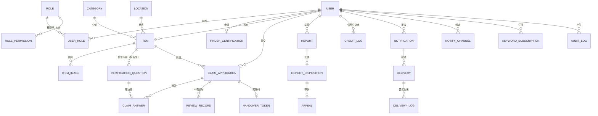

# 数据库设计

> 对应单元：4 设计建模｜检查点：第 6 次课（第 14 周）
> 负责人：架构 / 设计工程师｜状态：草稿，待评审
> 实现：开发期 SQLite 3（开启 WAL 与外键），部署期 PostgreSQL 15+；SQL 以 SQLite 方言为准，差异列在 §6

## 1. ER 图



## 2. 表设计

> 命名：表名小写下划线单数；状态字段用英文枚举码（中文映射见 §3）；所有表含 `id INTEGER PRIMARY KEY`。
> 时间统一存 UTC 的 ISO8601 字符串（SQLite）或 `timestamptz`（PostgreSQL）。

### user 用户

| 字段 | 类型 | 约束 | 说明 |
|---|---|---|---|
| id | integer | PK | |
| student_no | varchar(32) | unique, not null | 学工号，来自统一认证 |
| name | varchar(64) | not null | 姓名 |
| department | varchar(128) | | 院系 |
| contact_phone | varchar(32) | | 手机号，读取时脱敏 |
| contact_wechat | varchar(64) | | 微信号，读取时脱敏 |
| credit_score | integer | not null default 100 | 信用分 |
| auth_source | varchar(16) | not null default 'sso' | `sso` / `local`（演示兜底） |
| status | varchar(16) | not null default 'active' | active / banned / closed |
| created_at | varchar(32) | not null | |

**索引**：`unique(student_no)`、`index(status)`

### role / permission / role_permission / user_role

| 表 | 关键字段 | 说明 |
|---|---|---|
| role | `code` unique、`name` | student / finder / reviewer / admin |
| permission | `code` unique、`description` | 能力码，如 `claim:review_final` |
| role_permission | `role_id`、`permission_id` | 联合主键，角色→能力 |
| user_role | `user_id`、`role_id`、`granted_by`、`status` | 一人可多角色；`status=revoked` 表示已收回 |

**索引**：`unique(user_id, role_id)`

### finder_certification 拾取者认证

| 字段 | 类型 | 约束 | 说明 |
|---|---|---|---|
| id | integer | PK | |
| user_id | integer | FK→user, not null | |
| contact_phone | varchar(32) | not null | 认证时填写 |
| handover_locations | varchar(256) | not null | 可交接地点，逗号分隔 |
| statement | text | not null | 承诺书文本（勾选后落库快照） |
| status | varchar(16) | not null | none / pending / approved / rejected / frozen |
| review_comment | text | | 审核意见 |
| reviewer_id | integer | FK→user | |
| created_at / reviewed_at | varchar(32) | | |

**索引**：`unique(user_id, status) WHERE status='pending'`（同一人不能有两份待审申请）

### category 分类 / location 地点

| 表 | 字段 | 说明 |
|---|---|---|
| category | `code` unique、`name`、`sort`、`enabled` | 证件卡类 / 电子设备 / 书籍资料 / 衣物饰品 / 钥匙 / 其他 |
| location | `campus`、`building`、`floor`、`alias`、`enabled` | 校区—楼栋—楼层；`alias` 存"三教"这类简称，检索时同时匹配 |

**索引**：`index(enabled, sort)`、`index(campus, building)`

### item 发布（失物与招领共用一张表）

| 字段 | 类型 | 约束 | 说明 |
|---|---|---|---|
| id | integer | PK | |
| kind | varchar(8) | not null | `lost` / `found` |
| title | varchar(128) | not null | |
| description | text | not null | |
| category_id | integer | FK→category, not null | |
| location_id | integer | FK→location, not null | |
| happened_at | varchar(32) | not null | 丢失/拾取时间 |
| color / brand / marks | varchar(32) / varchar(64) / varchar(256) | | 物品特征（AC-11 值对象） |
| owner_id | integer | FK→user, not null | 发布人 |
| handover_location | varchar(256) | | 仅招领必填 |
| storage_note | varchar(256) | | 保管方式 |
| status | varchar(16) | not null default 'draft' | 见 §3 |
| version | integer | not null default 1 | 乐观锁 |
| created_at / updated_at / published_at / closed_at | varchar(32) | | |

**索引**

```sql
index(status, happened_at desc)          -- 列表默认排序
index(category_id, status)               -- 分类筛选
index(location_id, status)               -- 地点筛选
index(owner_id, status)                  -- 我的发布
unique(kind, owner_id, title, happened_at) -- 防重复发布
```

### item_image 图片

| 字段 | 类型 | 说明 |
|---|---|---|
| item_id | integer FK | |
| original_key | varchar(256) | 原图对象键，仅审核员与本人可换预签名 URL |
| masked_key | varchar(256) | 遮蔽图对象键，公开视图用 |
| status | varchar(16) | uploaded / pending（上传失败待重传） |
| width / height | integer | |

### verification_question 核验问题（仅招领）

| 字段 | 类型 | 说明 |
|---|---|---|
| item_id | integer FK, not null | |
| question | varchar(256) | 对失主可见 |
| answer_hash | char(64) | `sha256(salt + answer)`，用于快速比对 |
| answer_cipher | varchar(512) | 审核员可见的答案密文（课程实现用固定密钥的对称加密占位） |
| sort | integer | |

**约束**：招领发布至少 1 条（应用层 + 发布事务内校验）。

### claim_application 认领申请

| 字段 | 类型 | 说明 |
|---|---|---|
| id | integer PK | |
| item_id | integer FK, not null | 目标招领 |
| applicant_id | integer FK, not null | 申请人 |
| reason | text | 认领理由 |
| materials | text | 补充材料（文本/链接） |
| expected_handover_at | varchar(32) | |
| status | varchar(16) | 见 §3 |
| version | integer default 1 | 乐观锁 |
| reject_reason_code | varchar(32) | 驳回原因码 |
| created_at / updated_at / first_reviewed_at / final_reviewed_at | varchar(32) | |

**关键约束（NFR-2 的核心）**

```sql
-- 同一招领同一时刻最多一条"进行中"申请
CREATE UNIQUE INDEX uq_claim_active
  ON claim_application(item_id)
  WHERE status IN ('pending_first','pending_final','need_more','approved');
```

> 这是**部分唯一索引**，SQLite 与 PostgreSQL 都支持。它把"同一物品同一时刻只能有一条认领在流程中"从"应用层判断"
> 变成"数据库保证"，并发下也不可能出现两条进行中申请。
>
> **为什么把 `approved` 也包含在索引条件里**：终审通过到交接完成之间（最长 72 小时）物品处于"认领中"，
> 这段时间不允许有新的申请进来。因此索引条件必须包含 `approved`，直到交接完成（`completed`）才释放占位。
> 若漏写 `approved`，会出现"刚通过就被别人重新申请"的漏洞——这条是评审单 DEF-02 的整改结果。

### claim_answer 核验答案

| 字段 | 说明 |
|---|---|
| claim_id / question_id | 联合唯一 |
| answer | 申请人填写的答案 |
| is_correct | 与 `answer_hash` 比对的结果（仅内部使用，初审页展示） |

### review_record 审核记录

| 字段 | 说明 |
|---|---|
| claim_id、stage（first / final）、decision（approve / reject / request_more）、reason_code、comment、reviewer_id、created_at | |

**约束**：`unique(claim_id, stage)` —— 同一环节只能提交一次。

### handover_token 交接码

| 字段 | 说明 |
|---|---|
| claim_id FK unique | 一条申请同时只有一个有效码 |
| code_hash | `sha256(code + claim_id)`，不存明文 |
| expires_at | 生成后 72 小时 |
| consumed_at / consumed_by | 核销记录 |
| resend_count | 重发次数，≤2 |
| created_at | |

**索引**：`index(expires_at)`、`unique(claim_id)`

### item_status_log 状态变更日志

| 字段 | 说明 |
|---|---|
| target_type（item / claim / report / certification）、target_id、from_status、to_status、actor_id、reason、created_at | |

**索引**：`index(target_type, target_id, created_at)`

### report 举报 / report_disposition 处置 / appeal 申诉

| 表 | 关键字段 | 约束 |
|---|---|---|
| report | target_type（item/claim/user）、target_id、type（fake/impersonation/harassment/contraband/duplicate）、description、status、reporter_id | `unique(reporter_id, target_type, target_id)` 同一人同一对象只能报一次 |
| report_disposition | report_id FK unique、action（warning/unpublish/ban7/ban_forever/dismiss）、reason、comment、disposer_id、appeal_status | 一条举报一次处置 |
| appeal | disposition_id FK unique、applicant_id、materials、status、reviewer_id、conclusion | 一次处置最多一次申诉 |

### credit_log 信用分流水

| 字段 | 说明 |
|---|---|
| user_id、delta、reason、ref_type、ref_id、balance_after、created_at | |

**约束**：只追加不修改；`balance_after` 与 `user.credit_score` 必须一致（服务层同事务写）。

### notification / notify_channel / delivery / delivery_log

| 表 | 关键字段 | 说明 |
|---|---|---|
| notification | user_id、type、title、body、target_type、target_id、read_at | 站内消息，必达通道 |
| notify_channel | user_id、type（wechat/email）、credential_ref、verified_at、enabled | 凭据只存引用，不存明文 |
| delivery | notification_id、channel、status（pending/sending/sent/failed）、attempts、plan_at、sent_at、last_error | 待投递队列 |
| delivery_log | delivery_id、channel、result、latency_ms、created_at | 每次尝试一条 |

**索引**：`index(status, plan_at)`（补扫用）、`unique(notification_id, channel)`

### keyword_subscription / favorite

| 表 | 关键字段 | 约束 |
|---|---|---|
| keyword_subscription | user_id、keyword、filters、last_notified_at | `unique(user_id, keyword)` |
| favorite | user_id、item_id、note | `unique(user_id, item_id)` |

### audit_log 审计日志

| 字段 | 说明 |
|---|---|
| actor_id、action（`pii.read` / `image.original.read` / `report.dispose` / `config.update` / `user.role.grant` / `stats.export`）、target_type、target_id、ip、detail（JSON 元数据，**不含正文**）、created_at | |

**索引**：`index(actor_id, created_at)`、`index(action, created_at)`

### stat_metric 统计快照

| 字段 | 说明 |
|---|---|
| code、period（day/week/month）、dimension（all/category/location）、value、computed_at | |

> v0.2 的看板走实时聚合（数据量小，秒级可返回）；本表用于每日快照与历史对比，由调度任务在 02:30 写入。

### system_config 系统配置

| 字段 | 说明 |
|---|---|
| key unique、value、description、updated_by、updated_at | 信用分阈值、SLA 时长、留存天数、通道开关 |

## 3. 状态枚举与中文映射

| 对象 | 枚举码 | 中文 |
|---|---|---|
| item | draft | 草稿 |
| | pending_review | 待审核 |
| | published | 公示中 |
| | claiming | 认领中 |
| | handed_over | 已交接 |
| | closed | 已关闭 |
| | rejected | 已驳回 |
| | expired | 已过期 |
| claim | pending_first | 待初审 |
| | pending_final | 待终审 |
| | need_more | 待补充 |
| | approved | 已通过 |
| | completed | 已完成 |
| | rejected | 已驳回 |
| | withdrawn | 已撤回 |
| | expired | 已失效 |
| report | pending | 待受理 |
| | processing | 处理中 |
| | disposed | 已处置 |
| | rejected | 已驳回 |
| | closed | 已关闭 |

> 枚举值在 `app/models/enums.py` 中定义为 `StrEnum`，服务层状态机只接受这些值。

## 4. 全文检索（DES-DB-002）

**开发环境（SQLite）**：FTS5 虚表 + 字符级分词。

```sql
-- 入库时把中文按字拆开存进 search_text，例如 "校园卡" -> "校 园 卡"
CREATE VIRTUAL TABLE item_fts USING fts5(
    title, description, marks,
    content='item_search', content_rowid='id',
    tokenize='unicode61'
);
```

**查询**：把用户输入按字拆开，作为短语查询 `"校 园 卡"`，等价于子串匹配；ASCII 词（如 `AirPods`）保持整词。

**部署环境（PostgreSQL）**：`to_tsvector('simple', title || ' ' || description)` + GIN 索引，
中文需安装 `zhparser` 扩展；若不可安装，退回 `pg_trgm` 三元组索引。

**降级策略**：FTS5 不可用时（老版本 SQLite）自动退回 `LIKE '%q%'` + 分类/地点索引，
接口契约不变，仅在日志中标注 `search_mode=like`。

## 5. 约束与完整性

| 约束 | 说明 |
|---|---|
| 外键 | 全部显式声明；删除策略：`user` 注销时软删（`status=closed`），不物理删 |
| 唯一键 | `uq_claim_active`（核心）、`unique(claim_id, stage)`、`unique(reporter_id,target)`、`unique(student_no)` |
| 乐观锁 | `item.version`、`claim.version`；更新语句必须带 `AND version=?` |
| 状态机约束 | 状态迁移只能经 `services`，禁止直接 `UPDATE status`；代码审查 + 单测断言非法迁移抛错 |
| 金额/分数字段 | 无浮点，全整数 |
| 时间字段 | 统一 UTC ISO8601，展示层转本地 |

## 6. SQLite → PostgreSQL 差异

| 项 | SQLite | PostgreSQL |
|---|---|---|
| 主键自增 | `INTEGER PRIMARY KEY AUTOINCREMENT` | `bigserial` / `GENERATED BY DEFAULT AS IDENTITY` |
| 布尔 | `INTEGER 0/1` | `boolean` |
| 时间 | `TEXT`（ISO8601） | `timestamptz` |
| 部分唯一索引 | 支持 | 支持 |
| 全文检索 | FTS5 | `tsvector` + GIN（需 zhparser） |
| 并发写 | 单写锁（WAL） | MVCC |
| JSON | `TEXT` | `jsonb` |

## 7. 迁移策略

- 使用版本化 SQL 脚本：`migrations/0001_init.sql`、`0002_add_fts.sql`……
- 迁移脚本与代码同一 PR 提交，CI 在空库上跑一遍 `pytest`
- 禁止手工改线上表结构；每次发布前记录 `schema_version`

## 8. 数据保留

| 数据 | 保留 | 到期动作 |
|---|---|---|
| 发布与申请 | 180 天 | 归档：删图片对象、描述置空、保留统计字段 |
| 交接码 | 90 天 | 物理删除 |
| 投递记录 | 90 天 | 物理删除 |
| 举报与处置 | 2 年 | 归档 |
| 审计日志 | 2 年 | 归档 |
| 用户注销 | 立即 | 删除个人字段（姓名、联系方式），保留匿名化的统计事实 |
