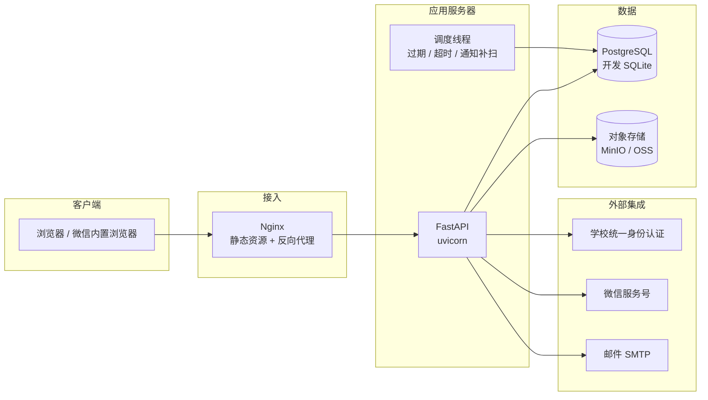

# 概要设计规约

> 对应单元：4 设计建模｜检查点：第 6 次课（第 14 周）
> 负责人：架构 / 设计工程师｜状态：草稿，待评审签字
> 依据：[SRS v1.0](../02-需求规约/SRS-v1.0.md)、[类图与CRC](../03-需求分析模型/类图与CRC.md)

## 1. 设计目标与约束

| 项 | 内容 |
|---|---|
| 质量属性优先级 | 安全（R2）＞ 一致性（R3）＞ 可测试性 ＞ 性能 ＞ 可演进性 |
| 关键约束 | 认领结论必须人工给出（C-05）；状态迁移只能经服务层（C-03）；敏感字段统一脱敏（C-02）；图片只经预签名 URL 访问（C-06） |
| 驱动需求 | REQ-F-013（认领申请）、REQ-F-016（终审）、REQ-F-017（交接码）、REQ-N-002（并发互斥）、REQ-N-003（脱敏与越权） |
| 不追求 | 高并发（校园场景峰值 <50 QPS）、多租户、跨校区多活 |

## 2. 体系结构风格与选型理由

**选择：前后端分离的分层架构 + 端口—适配器（六边形）风格的集成层。**

```
┌──────────────────────────────────────────────────────────────┐
│  表现层  Vue 3 + TypeScript + Vite（学生端 / 拾取者端 / 审核后台） │
└───────────────────────────┬──────────────────────────────────┘
                            │ REST / JSON（Bearer token）
┌───────────────────────────▼──────────────────────────────────┐
│  接口层  app/api      路由、鉴权依赖、入参校验、错误映射         │
├──────────────────────────────────────────────────────────────┤
│  应用层  app/services 用例编排、事务边界、状态机、脱敏           │
├──────────────────────────────────────────────────────────────┤
│  领域层  app/models   实体与不变量（状态枚举、能力判定、规则）    │
├──────────────────────────────────────────────────────────────┤
│  集成层  app/integrations  认证 / 对象存储 / 微信 / 邮件适配器   │
├──────────────────────────────────────────────────────────────┤
│  基础设施  app/core   配置、SQLite/PostgreSQL 连接、调度、审计   │
└──────────────────────────────────────────────────────────────┘
```

| 层次 | 职责 | 目录 | 不允许做什么 |
|---|---|---|---|
| 表现层 | 展示与交互 | `src/frontend` | 不做权限判定（只做展示层隐藏） |
| 接口层 | 参数校验、鉴权、错误码映射 | `app/api` | 不写业务规则、不开事务 |
| 应用层 | 用例编排、事务、状态机、脱敏 | `app/services` | 不拼 SQL 字符串、不直接返回 ORM 行 |
| 领域层 | 状态枚举、能力表、规则函数 | `app/models` | 不依赖 FastAPI、不访问网络 |
| 集成层 | 外部系统调用 | `app/integrations` | 不写库 |
| 基础设施 | 连接、配置、调度 | `app/core` | 不含业务判断 |

**为什么用适配器隔离外部系统**：认证（统一身份认证）、存储（对象存储）、通知（微信/邮件）三项都有"没有授权就无法实测"的共同点（见选题文稿 §15.1）。用适配器把"接口契约"与"实现"分开，课程环境用本地实现（本地账号、本地磁盘、控制台打印），换到生产只换适配器，上层代码不动。

## 3. 部署图



**部署约束**

- 单实例部署（课程场景），调度与 API 同进程；多实例时需把调度拆出并加分布式锁（不在本期）
- 数据库连接池上限 10；SQLite 开发模式开启 WAL 与 `busy_timeout=5000`
- 图片目录挂载到独立卷，不与应用代码同层

## 4. 模块划分

| 模块 | 职责 | 对应需求 | 关键类 |
|---|---|---|---|
| `auth` | 登录、会话、能力注入、角色授予 | REQ-F-001、REQ-F-002、REQ-F-026 | User、Role、Permission |
| `items` | 发布、编辑、下架、检索、相似推荐 | REQ-F-004 ~ REQ-F-011 | LostItem、FoundItem、ItemImage |
| `claims` | 申请、撤回、初审、终审、交接核销 | REQ-F-013 ~ REQ-F-017 | ClaimApplication、ReviewRecord、HandoverToken |
| `governance` | 举报、处置、信用分、申诉 | REQ-F-020 ~ REQ-F-022 | Report、ReportDisposition、CreditScore |
| `notify` | 站内消息、渠道绑定、投递与降级 | REQ-F-018、REQ-F-023 | Notification、NotifyChannel、DeliveryLog |
| `stats` | 个人统计、管理看板、导出 | REQ-F-024、REQ-F-025 | StatMetric |
| `admin` | 用户角色、基础数据、审计 | REQ-F-026、REQ-F-027 | SystemConfig、AuditLog |
| `security` | 脱敏、遮蔽、预签名、审计写入 | REQ-N-003、REQ-N-007 | SensitiveMask |

### 4.1 能力表（RBAC 的实现方式）

代码判定**能力**，不判定角色。角色是能力集合，存 `role_permission` 表，可配置。

| 能力码 | 含义 | student | finder | reviewer | admin |
|---|---|---|---|---|---|
| `item:create` | 发布失物 | ✓ | ✓ | | |
| `item:create_found` | 发布招领 | | ✓ | | |
| `item:update_own` | 编辑自己的发布 | ✓ | ✓ | | |
| `claim:create` | 提交认领 | ✓ | ✓ | | |
| `claim:withdraw_own` | 撤回自己的申请 | ✓ | ✓ | | |
| `claim:review_first` | 初审（仅自己发布的招领） | | ✓ | | |
| `claim:review_final` | 终审 | | | ✓ | |
| `claim:handover` | 核销交接码 | ✓ | ✓ | | |
| `report:create` | 举报 | ✓ | ✓ | | |
| `report:dispose` | 处置举报 | | | ✓ | |
| `pii:read` | 读取明文联系方式 | | | ✓ | |
| `stats:self` | 个人统计 | ✓ | ✓ | ✓ | ✓ |
| `admin:stats` | 管理看板 | | | ✓ | ✓ |
| `admin:config` | 基础数据与配置 | | | ✓ | ✓ |
| `admin:user` | 用户与角色 | | | | ✓ |
| `admin:audit` | 审计查询 | | | | ✓ |

### 4.2 信用分与阈值（可配置参数）

| 参数 | 默认值 | 作用 |
|---|---|---|
| `credit.initial` | 100 | 初始分 |
| `credit.publish_found_min` | 60 | 低于此值不能发布招领 |
| `credit.claim_min` | 40 | 低于此值不能提交认领 |
| `credit.penalty.warning` | −10 | 警告 |
| `credit.penalty.false_publish` | −30 | 虚假发布 |
| `credit.penalty.impersonation` | −40 | 冒领 |
| `credit.freeze_cert_below` | 60 | 低于此值冻结拾取者认证 |

参数存 `system_config`，改动写审计，不写死代码。

## 5. 关键设计决策

| ADR | 决策 | 状态 |
|---|---|---|
| [ADR-0001](adr/0001-架构风格选择.md) | 分层架构 + 集成适配器 | 已接受 |
| [ADR-0002](adr/0002-认领并发控制.md) | 用"部分唯一索引 + 乐观锁"保证同一物品只有一条进行中申请 | 已接受 |
| [ADR-0003](adr/0003-敏感信息分级与脱敏.md) | 字段级脱敏在序列化层统一做，原图走预签名 URL | 已接受 |

## 6. 统计口径（DES-OBS-001）

统计看板的每个数字必须有唯一口径，否则评审时对不上。

| 指标 | 口径 | 数据来源 |
|---|---|---|
| 发布量 | 按 `created_at` 落在周期内、状态 ≠ 草稿 的发布数 | item |
| 认领成功率 | 周期内 `completed` 申请数 ÷ 周期内 `created_at` 的申请数 | claim_application |
| 平均处理时长 | 周期内 `final_reviewed_at − created_at` 的中位数（不是均值，避免长尾拉偏） | claim_application |
| 分类分布 | 发布数按 `category_id` 分组占比 | item |
| 地点 Top10 | 发布数按 `location_id` 分组取前 10 | item |
| 举报处置率 | `disposed` 举报数 ÷ 周期内举报总数 | report |
| 超时率 | `final_reviewed_at − created_at > 48h` 的申请数 ÷ 周期内已终审申请数 | claim_application |
| 24 小时处理率 | `final_reviewed_at − created_at ≤ 24h` 的申请数 ÷ 周期内已终审申请数 | claim_application |

## 7. 内外接口

- 对外接口（前端调用）：见 [API契约](API契约.md)
- 对外部系统的调用：见 [详细设计](详细设计.md) 构件 5、6 与 `app/integrations/README.md`

## 8. 评审记录

| 评审人 | 结论 | 缺陷清单（不允许只写"都同意"） |
|---|---|---|
| | 通过 / 需修改 | |
